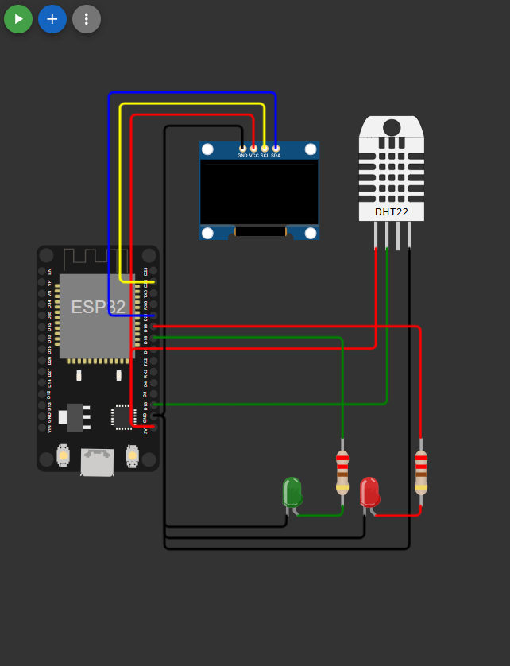
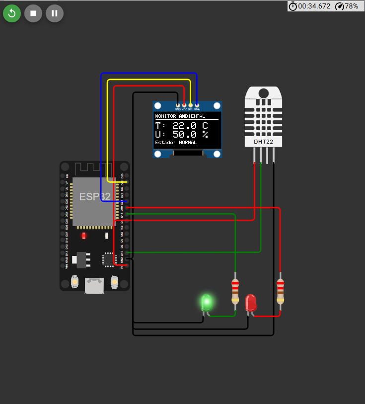
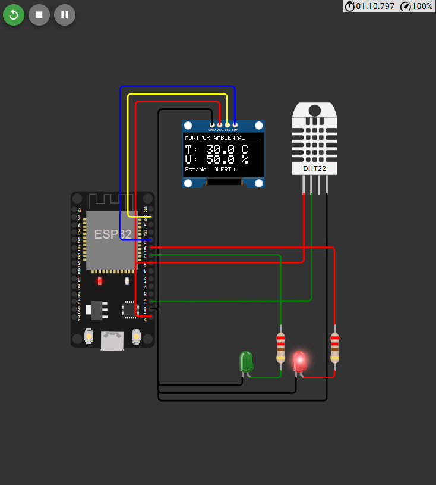
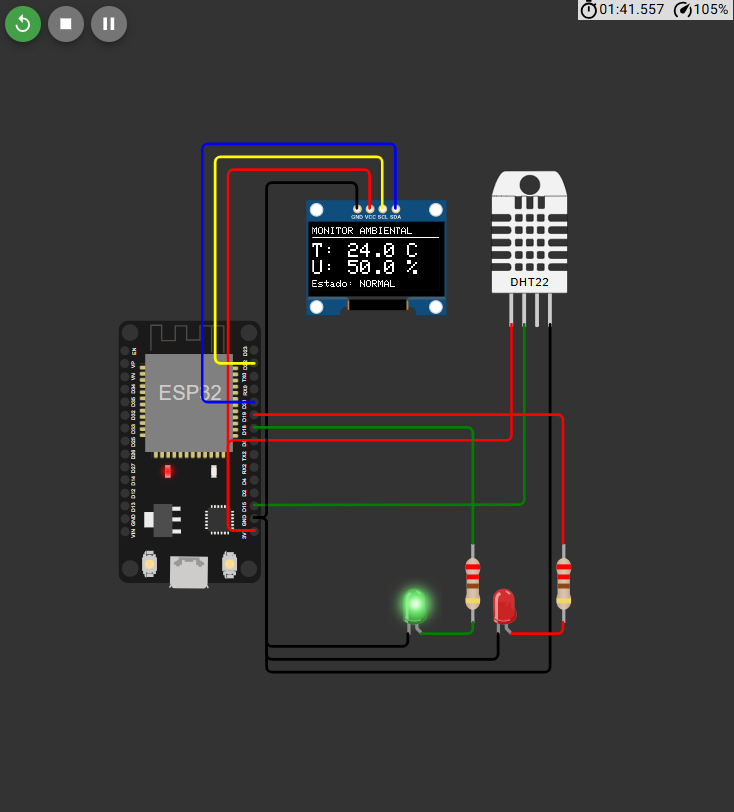
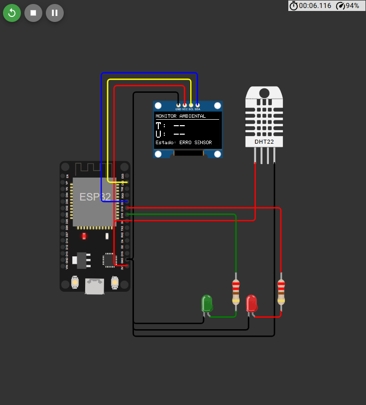

# Monitor ambiental com ESP32


Monitor de temperatura e umidade feito com ESP32, sensor DHT22 e display OLED, simulado no [Wokwi](https://wokwi.com/). O sistema lê o sensor, mostra os valores no display e sinaliza por LEDs se a temperatura está normal ou em alerta. Se o sensor falhar, mostra `ERRO SENSOR` em vez de agir com um dado inválido.


**Simulação online:** [abrir o projeto no Wokwi](https://wokwi.com/projects/479891308176792577)

## Objetivo

Demonstrar, em simulação, uma cadeia completa de monitoramento: leitura de um sensor, validação do dado, decisão por uma regra simples e indicação visual. O ponto central é que o dado só é usado se for confiável: uma leitura inválida nunca entra na comparação com o limite de temperatura.

## Funcionalidades

- Leitura de temperatura e umidade com o DHT22, uma vez a cada 2 s (intervalo mínimo do sensor).
- Exibição no OLED de temperatura (`C`), umidade (`%`) e estado.
- Regra de temperatura com limite de 30,0 °C:
  - abaixo de 30,0 °C: **NORMAL**, LED verde aceso;
  - 30,0 °C ou mais: **ALERTA**, LED vermelho aceso;
  - falha de leitura: **ERRO SENSOR**, os dois LEDs apagados.
- Validação da leitura (status da biblioteca, NaN e faixa do sensor) antes de qualquer decisão.
- Recuperação automática: se o sensor volta a responder, o sistema retorna ao funcionamento normal sem reiniciar.
- Limite de alerta numa constante (`LIMITE_ALERTA_C`), fácil de alterar.
- Temporização com `millis()`, sem travar o programa.
- Registro de cada leitura e estado no Serial Monitor.

## Componentes e ferramentas

| Item | Descrição |
|------|-----------|
| Microcontrolador | ESP32 DevKit V1 |
| Sensor | DHT22 (temperatura e umidade) |
| Display | OLED SSD1306 128x64, I2C |
| LEDs | 1 verde e 1 vermelho, cada um com resistor de 220 Ω |
| Simulador | Wokwi |
| Linguagem | C++ (Arduino) |
| Bibliotecas | `DHT sensor library for ESPx`, `Adafruit GFX Library`, `Adafruit SSD1306` |

A biblioteca de DHT escolhida é a recomendada pela documentação do Wokwi para o ESP32.

## Conexões

| Componente | Pino | ESP32 |
|------------|------|-------|
| DHT22 | VCC / GND | 3V3 / GND |
| DHT22 | SDA (dados) | GPIO 15 |
| OLED SSD1306 | VCC / GND | 3V3 / GND |
| OLED SSD1306 | SDA | GPIO 21 |
| OLED SSD1306 | SCL | GPIO 22 |
| LED verde | via resistor de 220 Ω | GPIO 18 |
| LED vermelho | via resistor de 220 Ω | GPIO 19 |

Detalhes completos, incluindo cada fio do diagrama, em [`docs/conexoes.md`](docs/conexoes.md).



## Como abrir e executar no Wokwi

### Opção A: abrir o projeto pronto

1. Abra o [projeto no Wokwi](https://wokwi.com/projects/479891308176792577).
2. Clique no botão verde **Play** e abra o Serial Monitor para acompanhar as leituras.

### Opção B: montar a partir dos arquivos deste repositório

1. Acesse [wokwi.com](https://wokwi.com/) e entre na sua conta (ou crie uma).
2. Clique em **New Project** e escolha **ESP32**, com o modelo ESP32 de Arduino (C++).
3. No editor do projeto, abra o `sketch.ino` e substitua o conteúdo pelo deste repositório.
4. Abra a aba `diagram.json` e substitua o conteúdo pelo [`diagram.json`](diagram.json) deste repositório.
5. Se não existir a aba `libraries.txt`, crie o arquivo e cole o conteúdo de [`libraries.txt`](libraries.txt).
6. Confira no circuito se aparecem o ESP32, o DHT22, o OLED, dois LEDs e dois resistores com os fios ligados.
7. Clique no botão verde **Play**. Abra o Serial Monitor para acompanhar as leituras.

## Como testar NORMAL e ALERTA

Com a simulação rodando, clique no DHT22 para abrir os sliders de temperatura e umidade. O display e os LEDs se atualizam em até 2 s.

| Ação | Resultado esperado |
|------|--------------------|
| Temperatura abaixo de 30,0 °C (por exemplo, 22 °C) | `Estado: NORMAL`, LED verde aceso |
| Temperatura exatamente em 30,0 °C | `Estado: ALERTA`, LED vermelho aceso |
| Temperatura acima de 30,0 °C (por exemplo, 35 °C) | `Estado: ALERTA`, LED vermelho aceso |
| Voltar a uma temperatura abaixo de 30,0 °C | Volta a `NORMAL`, sem reiniciar |
| Mudar só a umidade | O valor de umidade muda; o estado não |
| Parar a simulação, remover o fio de dados do DHT22 (`esp:D15` ↔ `dht1:SDA`) e rodar | `ERRO SENSOR`, `T: --`, `U: --`, os dois LEDs apagados |

Para reproduzir a falha, na aba `diagram.json` apague a linha da ligação `esp:D15` → `dht1:SDA`, rode a simulação e, depois, recoloque a linha para restaurar o circuito.

## Capturas da simulação

| Estado NORMAL (22 °C) | Estado ALERTA (30,0 °C) |
|:---:|:---:|
|  |  |

| Retorno ao NORMAL (24 °C) | ERRO SENSOR (fio de dados removido) |
|:---:|:---:|
|  |  |

## Testes

Os casos executados (abaixo, no limite exato e acima de 30 °C, retorno ao normal, alteração da umidade, atualização contínua e falha do sensor) estão em [`docs/testes.md`](docs/testes.md), com a evidência de cada um e a lista do que não foi executado. Todos os testes foram feitos em simulação.

## Documentação

- [`docs/funcionamento.md`](docs/funcionamento.md): leitura, validação, regra de temperatura, LEDs, display e tempo.
- [`docs/conexoes.md`](docs/conexoes.md): tabela de conexões e pinos.
- [`docs/testes.md`](docs/testes.md): casos de teste e resultados observados.

## Estrutura de pastas

```
esp32-monitor-ambiental/
├── sketch.ino          # código C++ do ESP32
├── diagram.json        # circuito do Wokwi
├── libraries.txt       # bibliotecas usadas
├── README.md
├── .gitignore
├── docs/
│   ├── funcionamento.md
│   ├── conexoes.md
│   └── testes.md
└── images/             # capturas de tela reais da simulação
```

## Limitações da simulação

- Todos os testes foram feitos no Wokwi. Não houve validação em hardware real.
- O DHT22 simulado entrega valores exatos e sem ruído, e só se consegue provocar falha removendo o fio de dados. Um sensor real tem variações e outros modos de falha.
- O DHT22 simulado não precisa de resistor de pull-up na linha de dados. Em hardware real, o sensor de 4 pinos costuma precisar de um (tipicamente na faixa de 4,7 kΩ a 10 kΩ), enquanto muitos módulos de 3 pinos já o trazem.
- O GPIO 15 é um pino de *strapping* do ESP32. Em hardware real, convém conferir se o circuito ligado a ele não atrapalha a inicialização.
- O desempenho do simulador varia (nos testes, entre cerca de 78 % e 105 % do tempo real), então os tempos medidos nos prints são aproximados.
- Os ramos de NaN e de valor fora da faixa do sensor existem no código, mas não puderam ser provocados no simulador.

## Melhorias futuras possíveis

Nenhuma destas está implementada.

- Histerese no alerta, para evitar que o estado fique alternando quando a temperatura oscila perto de 30 °C.
- Alerta sonoro com um buzzer.
- Alerta também por umidade.
- Alterar o limite sem recompilar, por exemplo com um botão ou potenciômetro.
- Envio das leituras por Wi-Fi.
- Teste em hardware real.

## Autoria

Projeto pessoal de estudo e pesquisa, desenvolvido por **Larissa Rafaela Ribeiro de Souza** ([@larissaribeiro-dev](https://github.com/larissaribeiro-dev)).
