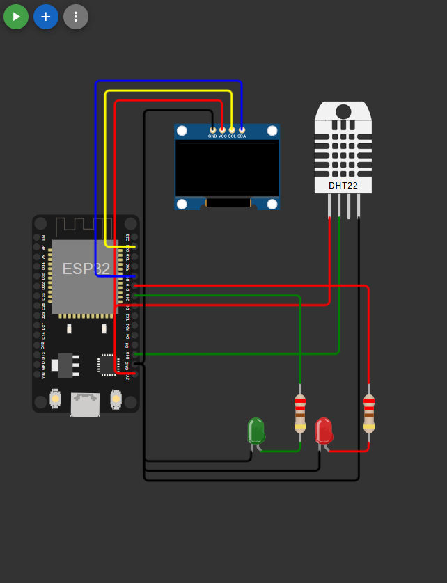

# Conexões e pinos

Este documento descreve as ligações do circuito exatamente como estão no arquivo [`diagram.json`](../diagram.json). Os GPIOs correspondem às constantes no topo do [`sketch.ino`](../sketch.ino).

## Tabela de conexões

| Componente | Pino do componente | Terminal / GPIO do ESP32 | Função |
|------------|--------------------|--------------------------|--------|
| DHT22 | VCC | 3V3 | Alimentação |
| DHT22 | SDA (dados) | GPIO 15 | Linha de dados do sensor |
| DHT22 | NC | não conectado | Pino sem função |
| DHT22 | GND | GND | Referência |
| OLED SSD1306 | VCC | 3V3 | Alimentação |
| OLED SSD1306 | GND | GND | Referência |
| OLED SSD1306 | SDA | GPIO 21 | Dados I2C |
| OLED SSD1306 | SCL | GPIO 22 | Clock I2C |
| Resistor R1 (220 Ω) | pino 1 | GPIO 18 | Limita a corrente do LED verde |
| LED verde | ânodo (A), via R1 | R1, pino 2 | Indica NORMAL |
| LED verde | cátodo (C) | GND | Retorno da corrente |
| Resistor R2 (220 Ω) | pino 1 | GPIO 19 | Limita a corrente do LED vermelho |
| LED vermelho | ânodo (A), via R2 | R2, pino 2 | Indica ALERTA |
| LED vermelho | cátodo (C) | GND | Retorno da corrente |

Todos os componentes compartilham o mesmo GND (terminal `GND.1` do ESP32 no Wokwi). A alimentação do DHT22 e do OLED vem do terminal 3V3.

## Ligações no `diagram.json`

Os identificadores abaixo são os usados no arquivo: `esp` (ESP32 DevKit V1), `dht1` (DHT22), `oled1` (SSD1306), `ledVerde`, `ledVermelho`, `r1` e `r2`.

| De | Para | Cor do fio |
|----|------|------------|
| `esp:3V3` | `dht1:VCC` | vermelho |
| `esp:GND.1` | `dht1:GND` | preto |
| `esp:D15` | `dht1:SDA` | verde |
| `esp:3V3` | `oled1:VCC` | vermelho |
| `esp:GND.1` | `oled1:GND` | preto |
| `esp:D21` | `oled1:SDA` | azul |
| `esp:D22` | `oled1:SCL` | amarelo |
| `esp:D18` | `r1:1` | verde |
| `r1:2` | `ledVerde:A` | verde |
| `ledVerde:C` | `esp:GND.1` | preto |
| `esp:D19` | `r2:1` | vermelho |
| `r2:2` | `ledVermelho:A` | vermelho |
| `ledVermelho:C` | `esp:GND.1` | preto |

## Observações

- O endereço I2C do OLED é `0x3C`. Ele foi confirmado em simulação: o teste isolado do display registrou, no Serial Monitor, que um dispositivo respondeu nesse endereço (ver [`testes.md`](testes.md)).
- O terminal `D15` é o rótulo do GPIO 15 na placa ESP32 DevKit V1 do Wokwi, assim como `D18`, `D19`, `D21` e `D22`.
- O DHT22 do Wokwi não exige resistor de pull-up externo na linha de dados. Em hardware real isso precisa ser verificado (ver as limitações no [README](../README.md)).
