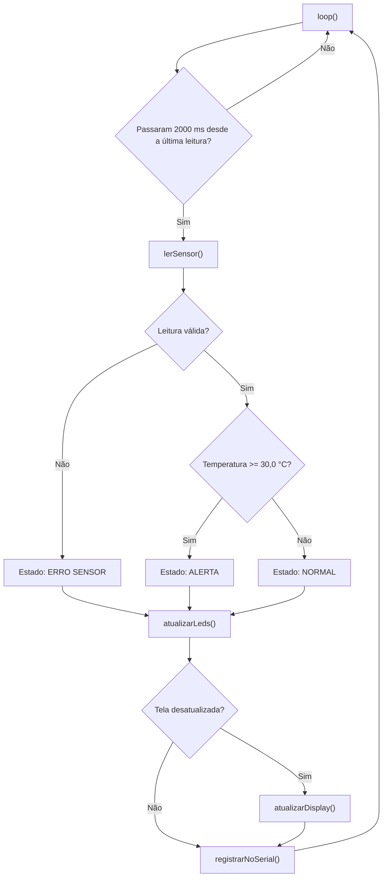

# Funcionamento do programa

Este documento explica como o [`sketch.ino`](../sketch.ino) lê o sensor, valida os dados, decide o estado e atualiza LEDs, display e Serial Monitor.

## Visão geral

A cada 2 segundos o programa executa a mesma cadeia de passos:



## Tempo

O programa não usa `delay()` no laço principal. O `loop()` compara `millis()` com o instante da última leitura e só continua quando passaram `INTERVALO_LEITURA_MS` (2000 ms). Esse valor é igual ao intervalo mínimo que a própria biblioteca informa para o DHT22 (2000 ms, mostrado no Serial Monitor nos testes). A primeira leitura acontece logo na partida, sem esperar o primeiro intervalo.

## Leitura e validação (`lerSensor()`)

A função devolve uma estrutura `Leitura` com temperatura, umidade e um campo `valida`. A leitura só é marcada como válida se passar nas três verificações, nesta ordem:

1. O status informado pela biblioteca é "sem erro". Se o fio de dados for removido, por exemplo, o status é `TIMEOUT`.
2. Nenhum dos valores é NaN (*Not a Number*).
3. Temperatura entre -40 e 80 °C e umidade entre 0 e 100 %, que é a faixa de medição do DHT22.

Quando qualquer verificação falha, a função registra o motivo no Serial Monitor e devolve `valida = false`, sem valores aproveitáveis.

## Regra de estado (`determinarEstado()`)

| Condição | Estado |
|----------|--------|
| Leitura inválida | `ERRO SENSOR` |
| Temperatura < 30,0 °C | `NORMAL` |
| Temperatura >= 30,0 °C | `ALERTA` |

Uma leitura inválida nunca entra na comparação de temperatura: o programa não toma decisão com dado inválido. A umidade é apenas exibida e não influencia o estado.

A comparação é feita em décimos de grau. O DHT22 tem resolução de 0,1 °C, então comparar `300 >= 300` em números inteiros evita que um pequeno erro de arredondamento de ponto flutuante (por exemplo, 29,999998) faça o limite exato de 30,0 °C ser classificado como NORMAL.

## LEDs (`atualizarLeds()`)

| Estado | LED verde (GPIO 18) | LED vermelho (GPIO 19) |
|--------|---------------------|------------------------|
| NORMAL | aceso | apagado |
| ALERTA | apagado | aceso |
| ERRO SENSOR | apagado | apagado |

Em ERRO SENSOR os dois LEDs ficam apagados. Essa foi a regra adotada para esse caso: nenhum dos dois indicadores de condição ambiental deve parecer válido quando não há medição confiável.

## Display (`atualizarDisplay()`)

O OLED mostra, de cima para baixo:

1. O título `MONITOR AMBIENTAL` e uma linha separadora.
2. A temperatura, no formato `T: 25.0 C` (ou `T: --` se a leitura for inválida).
3. A umidade, no formato `U: 50.0 %` (ou `U: --`).
4. A linha `Estado: NORMAL`, `Estado: ALERTA` ou `Estado: ERRO SENSOR`.

Decisões de projeto:

- A unidade é escrita como `C`, e não `°C`, porque a fonte padrão do display não garante o símbolo de grau.
- A tela é limpa e redesenhada por inteiro a cada atualização, para não sobrarem caracteres antigos quando o número de dígitos muda.
- O display só é redesenhado quando a temperatura, a umidade ou o estado mudam em relação ao que já está na tela (`displayPrecisaAtualizar()`). Para leituras inválidas, basta o estado ter mudado, pois não há valores para comparar.

## Serial Monitor

A cada leitura o programa escreve uma linha, por exemplo:

```
Temperatura: 30.0 C | Umidade: 50.0 % | Estado: ALERTA
```

Quando a leitura é inválida, escreve o motivo e o estado:

```
Falha na leitura. Status: TIMEOUT
Estado: ERRO SENSOR
```

Se o sensor falhar, o programa não trava: continua tentando ler no intervalo seguinte e volta ao funcionamento normal assim que a leitura voltar a ser válida. Se o OLED não for encontrado na inicialização, o programa para e avisa no Serial Monitor.

## Constantes que podem ser alteradas

Todas ficam no topo do `sketch.ino`.

| Constante | Valor atual | Para que serve |
|-----------|-------------|----------------|
| `LIMITE_ALERTA_C` | 30.0 | Temperatura a partir da qual o estado é ALERTA |
| `INTERVALO_LEITURA_MS` | 2000 | Tempo entre leituras (não usar menos que o mínimo do DHT22) |
| `PINO_DHT` | 15 | GPIO do DHT22 |
| `PINO_SDA`, `PINO_SCL` | 21, 22 | GPIOs do I2C |
| `PINO_LED_VERDE`, `PINO_LED_VERMELHO` | 18, 19 | GPIOs dos LEDs |
| `ENDERECO_OLED` | 0x3C | Endereço I2C do display |

Se mudar um pino, o `diagram.json` precisa ser ajustado para a mesma ligação (ver [`conexoes.md`](conexoes.md)).

## Biblioteca do sensor

O projeto usa a biblioteca `DHT sensor library for ESPx` (arquivo de cabeçalho `DHTesp.h`). A documentação do Wokwi recomenda essa biblioteca para o ESP32 e avisa que outras bibliotecas de DHT podem não funcionar de forma confiável nele. As dependências estão em [`libraries.txt`](../libraries.txt).
